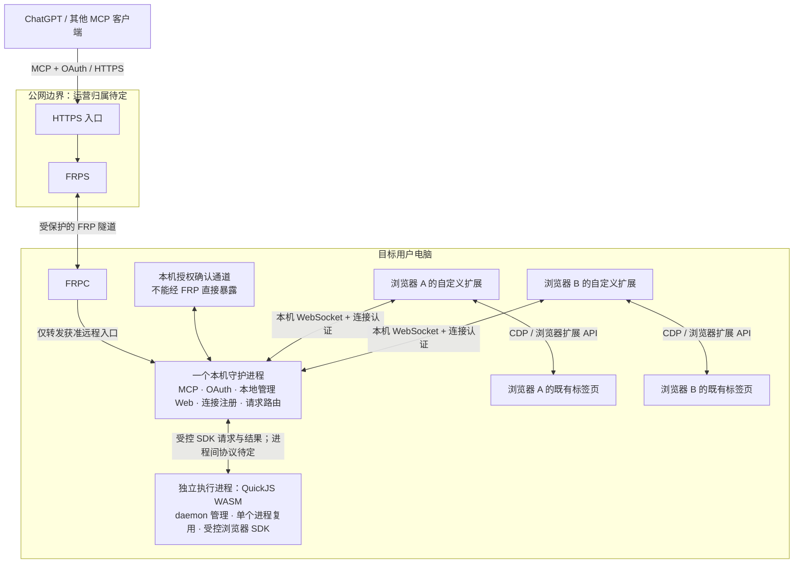

# Avru 技术设计

## 1. 设计状态与输入

本文将 [产品需求](requirements.md) 转为可继续细化的技术边界。多浏览器连接、MCP OAuth、FRP、同机确认及 CLI/Web 生命周期分工已有用户依据；扩展到守护进程现已确定使用本机 WebSocket，扩展通过 CDP / 浏览器扩展 API 控制网页（D-11）。受控脚本使用 QuickJS WASM，运行于由 daemon 管理的单个独立、可复用执行进程（D-12）；不放入 daemon 主进程。扩展工程采用 WXT + TypeScript，开发包管理继续使用 pnpm（D-13），不改变用户的 npx 入口。服务端、管理 Web、存储与测试工具选型见 D-14 和 §2.3。接口命名、配对密码学协议、部署细节和凭据生命周期尚未冻结。

下文使用三种表述：

- **已确认约束**：来自产品需求，不在实现时随意改变。
- **设计建议**：为满足约束提出的可评审方案，不冒充已确认决定或已实现能力。
- **待决定事项**：会影响后续实现，统一在 [开放问题](decisions.md#2-开放问题) 记录。

本文主体描述目标逻辑设计；当前工程目录与边界见 §2.4，实施进度和验证回执由初始化记录维护。文中的数据字段和工具名称是接口草案，不是可调用 API。协议版本和第三方兼容性需在实现前核实。

## 2. 系统上下文与逻辑架构

图中的两个浏览器仅表示多对一关系，不预先确定支持 Chrome、Edge、Firefox 或 Safari 的具体集合。一个浏览器的多个配置也需要可区分身份，但配置支持范围仍待决定。

### 2.1 组件责任

| 组件                   | 负责                                                                                                                 | 不负责                                                                                                |
| ---------------------- | -------------------------------------------------------------------------------------------------------------------- | ----------------------------------------------------------------------------------------------------- |
| MCP 客户端 / AI        | 发现可用目标、理解任务、选择明确的浏览器和标签页、请求操作与核对结果                                                 | 不持有扩展内部凭据，不凭页面内容提升权限                                                              |
| 公网 HTTPS 入口 / FRPS | TLS 接入与设备入口路由、隧道承载                                                                                     | 不能仅靠路由结果授予浏览器控制权                                                                      |
| FRPC                   | 建立目标电脑到公网服务的隧道，报告连接状态                                                                           | 不作为同机确认的身份依据                                                                              |
| 守护进程               | MCP 服务、授权状态、浏览器连接注册、目标校验、操作调度与结果关联；提供本地管理 Web                                   | 不把一个浏览器的连接与标签标识套到另一个浏览器                                                        |
| 本地管理 Web           | 浏览器选择、扩展安装引导、连接方式配置、运行状态展示                                                                 | 不静默安装扩展，不要求用户在 AI 每次操作前手动选择目标，不因打开页面自动授予 OAuth 权限               |
| 自定义扩展             | 经本机 WebSocket 连接守护进程，报告能力与标签页；使用 CDP / 扩展 API 执行动作并反馈页面状态                          | 不绕过浏览器权限、系统页面限制或用户停止操作                                                          |
| QuickJS WASM 执行进程  | 由 daemon 管理生命周期，加载 WASM 引擎执行 AI 脚本，通过受控浏览器 SDK 请求守护进程操作；单个独立进程复用            | 不直接连接扩展，不持有 OAuth/配对密钥，不获得通用 shell、文件或网络访问；进程复用不等于跨任务共享状态 |
| 本机确认入口           | 显示本次授权的目标电脑、客户端和控制范围，收集确认，经可信本机路径提交结果                                           | 不因公网网页访问到 loopback 或处于同一 NAT 就自动批准                                                 |
| CLI / npx 入口         | 首次安装与自启动配置；重跑检查更新并保留设置；确保守护进程启动、打开本地管理 Web；通过独立卸载命令停止服务并清理安装 | 不代装用户的 Node.js/npm，不承担 Web 的浏览器/连接配置交互，不把退出 npx 终端等同于停止已安装服务     |

公网入口、OAuth 授权服务及证书的最终运营位置仍须确定。图按前述讨论把 MCP 与授权管理放在守护进程；是否引入独立云端授权组件属于重大变更，不能在实现中悄悄替换。

### 2.2 信任边界

1. AI/MCP 客户端与公网入口之间：OAuth 身份、授权范围、TLS 与请求有效性。
2. 公网/FRP 与目标电脑之间：隧道认证与设备路由；远程可调用接口和本机确认接口必须隔离。
3. 守护进程与扩展之间：连接来源认证、协议版本和目标身份绑定。
4. 扩展与网站页面之间：网页数据不可信；页面脚本或文字不能发起管理级命令或修改授权。
5. QuickJS 与守护进程之间：脚本请求不可信，守护进程在每次实际 SDK 操作前检查授权、目标与动作范围；执行引擎本身不是权限判定者。
6. 不同电脑、操作系统账号、浏览器配置之间：身份与授权不能因名称相同而合并。跨 OS 账号策略是 Q-02 的阻塞项。

如果公网代理终止 TLS，它可能接触页面文本、截图和操作数据，不能声称“云端看不到”。TLS 终止位置、隧道保护以及运营者可见性必须在部署设计中明确。

### 2.3 服务端、管理 Web、存储与测试选型

D-14 确认以下工程选型。此处记录组件的目标责任边界，不表示完整功能已实现；初始依赖与开发入口的验证范围见 §2.4。

| 领域               | 已选技术                | 责任与边界                                                                                                                                      |
| ------------------ | ----------------------- | ----------------------------------------------------------------------------------------------------------------------------------------------- |
| 守护进程 HTTP 服务 | Fastify                 | 承载 HTTP 路由及本地管理 Web/API；远程 MCP/OAuth 与本机配对/确认入口仍按 §5 分隔。框架本身不提供已验证的同机授权方案。                          |
| 本机 WebSocket     | ws                      | 在 daemon 侧实现扩展连接及协议处理；扩展侧使用浏览器 WebSocket API。沿用 D-11 的认证、身份、重连和消息限额要求，不以选库替代协议合同。          |
| MCP 协议           | 官方 MCP TypeScript SDK | 实现对外 MCP 协议接入；具体 SDK/协议版本、HTTP 传输接线、OAuth 合同及目标 ChatGPT 兼容测试待定，不能把 SDK 接入等同于授权已实现。               |
| 本地管理 Web       | React + Vite            | React 组织管理交互，Vite 负责开发与构建；目标是由 daemon 提供构建后的管理页面，不要求终端用户另开开发服务器。不得据此扩大 Web 的授权范围。      |
| 本机持久化         | SQLite，暂不引入 ORM    | 保存经确认需要持久化的数据；表结构、迁移和访问层合同仍需设计，不承诺自动跨数据库适配。敏感凭据保护仍遵循 §7，不因选择 SQLite 就默认以明文入库。 |
| 测试               | Vitest + Playwright     | Vitest 用于单元/集成测试，Playwright 用于适用的浏览器/Web 端到端验证；Playwright 是测试工具，不替换产品运行时的扩展 + WS + CDP 路线。           |

该组合将服务路由、连接、协议、管理界面、存储和验证工具分工明确；采用现成框架仍需维护依赖兼容、适配层与安全合同。SQLite 对应本机数据需求，本轮没有批准云端 PostgreSQL、多租户存储或 ORM 引入。测试框架选择不构成浏览器真实连接、跨平台安装或安全验收通过的证据。

已安装依赖的开发版本由 package.json / pnpm-lock.yaml 固定，工程基线见 §2.4；完整产品支持范围、数据库 schema/迁移、Fastify 与 MCP/WS 的接口接线仍待确定。QuickJS 的具体 WASM 包/版本、runner IPC 和任务调度仍见 Q-14；同机授权、首次配对、权限生命周期仍见 Q-03/Q-07，未由本轮选型消除。

### 2.4 初始工程布局

采用 pnpm workspace 单仓库，开发基线为 Node.js 24.22.1、pnpm 11.25.0。基线是可复现开发环境选择，不等于正式产品最低版本或 Windows/macOS 全面支持承诺。第三方直接依赖固定版本，完整解析结果以根目录锁文件为准。

| 目录                | 责任                                            | 当前边界                                                      |
| ------------------- | ----------------------------------------------- | ------------------------------------------------------------- |
| `apps/cli`          | npx 生命周期入口                                | 只实现帮助/版本；安装、升级、卸载请求失败关闭，不进行系统变更 |
| `apps/daemon`       | 可信授权与路由、MCP/OAuth、WS、持久化和页面托管 | 只有 health-only Fastify 入口；不开放尚未认证的管理/控制端点  |
| `apps/web`          | 本地管理交互                                    | React + Vite 静态开发占位，尚未连接 daemon                    |
| `apps/extension`    | 浏览器连接和获准控制                            | WXT MV3 popup 骨架，暂不申请 debugger、站点或本地连接权限     |
| `packages/runner`   | 独立 QuickJS WASM 执行进程                      | 只有边界说明，包、IPC 和执行语义尚未冻结                      |
| `packages/protocol` | 跨组件消息类型/编码与验证                       | 只有边界说明；不可引用不存在的可用协议                        |
| `tests/e2e`         | 管理 Web 与后续集成验收                         | 当前仅占位页面测试，不代表浏览器控制验收                      |

依赖方向是应用入口使用共享协议，runner 经受控 IPC 请求 daemon，extension 经 WS 请求/响应 daemon；共享协议不得反向导入应用的业务实现。尚未实现的两个 packages 不设假 package.json 或空成功命令。SQLite 没有 schema/驱动实现；MCP SDK 和 ws 已固定为 daemon 依赖但尚未接线；QuickJS WASM 具体包不在本轮擅自决定。

工程命令与实际检查记录见 [初始化记录](development/initialization.md)。初始化交付范围不扩展到发布、宿主安装、开机启动或实际浏览器权限。

## 3. 多浏览器发现与目标路由

### 3.1 已确认的使用体验

连接完成后，AI 一次发现所有已连接浏览器及其标签页，自行判断任务需要操作哪一个。用户不需要先在扩展里选一个标签页才能让 AI 看到它，也不需要逐个浏览器授权后再切换。

“全部可见”指可发现目标集合，不要求在连接时把所有标签页的全文和截图一次发送给 AI。建议先返回目标元数据，再按任务读取页面内容，降低无关数据暴露和结果体积。

### 3.2 建议的身份模型

| 对象               | 草案身份与状态                                            | 作用                                               |
| ------------------ | --------------------------------------------------------- | -------------------------------------------------- |
| Device             | deviceId、安装身份、当前运行实例                          | 区分物理目标安装，不能仅用设备名称或 IP            |
| BrowserConnection  | connectionId、浏览器/配置显示名、连接代次、能力、在线状态 | 区分同浏览器多个连接，代次防止重连后旧引用误用     |
| Tab                | connectionId + tabId + 连接代次，页面版本                 | 浏览器 tabId 只在其自身上下文内解释                |
| AuthorizationGrant | 客户端、目标设备、允许范围、状态                          | 将 OAuth 授权绑定到正确设备，具体期限/刷新机制待定 |
| Operation          | requestId、授权身份、目标引用、动作、状态                 | 把执行结果关联回原请求，不以“已转发”冒充成功       |

这些是逻辑字段，不确定数据库、序列化格式或最终公开命名。标签页关闭、浏览器重连、配置切换和页面导航后，要重新判断目标引用是否仍有效。

### 3.3 发现结果与执行语义建议

- 发现结果包含浏览器连接、标签页标识、可用标题/URL、活动状态、可执行能力和受限原因。标题与 URL 也可能敏感，只发给已授权客户端。
- 跨浏览器的相同 tabId 不得相互替代。目标失效时返回明确错误，不自动切换到相似标题的页面。
- 读取后的页面引用应绑定页面版本或导航代次。页面已变化时重新观察，避免按过期定位点击。
- 多客户端或多任务同时操作同一标签页时，建议串行处理写操作或返回冲突；不能交错输入导致无法归因的结果。是否支持多客户端并发见 Q-09。
- 用户主动操作、导航和关闭页面都应触发状态更新。不能把上一次截图当成当前页面事实。
- 新连接是否继承既有 grant 由 Q-04 决定；无论采用何种生命周期，都保持 AI 不必人工逐页选目标的已确认体验。

## 4. MCP 能力与接口草案

MCP 是正式对外接口，OAuth 是正式远程授权方式。传输版本、客户端注册方式、服务发现与兼容范围仍需按选定 MCP 规范核对，不能仅凭服务返回 JSON 就宣称兼容 ChatGPT。

建议按“发现 → 观察 → 操作 → 验证”组织工具：

| 能力组              | 草案输入                           | 草案输出                                 | 当前状态                           |
| ------------------- | ---------------------------------- | ---------------------------------------- | ---------------------------------- |
| 发现浏览器与标签页  | 分页/过滤条件（如最终需要）        | 完整可分页目标集合、能力、在线/受限状态  | R-03、R-04 所需；具体 schema 待定  |
| 观察页面            | 明确目标引用、读取方式             | 文本/结构/截图、页面版本、受限或截断说明 | 先前建议，具体范围待确认           |
| 执行浏览器动作      | 目标引用、动作、参数、前置页面状态 | 执行状态、后置状态或结果引用             | 点击、输入等候选，完整动作集待确认 |
| 连接与控制状态      | 当前连接或操作引用                 | 在线状态、当前操作、失败原因             | 建议                               |
| 停止控制 / 撤销授权 | 具体授权或操作对象                 | 撤销/停止结果及未能撤回的已执行动作      | 安全设计建议，语义待确认           |

公开接口应区分协议错误、授权失败、目标离线、标签页不存在、页面已变化、页面不可访问、动作不支持、排队冲突、超时与结果未知。错误不能一律包装为成功文本。

对可能产生副作用的动作，建议输出“未执行”“已执行且已核对”“可能执行但结果未知”等状态。不能在超时后自动重放点击、提交表单或输入操作。只读操作的重试也需重核目标与授权。

本版不提供任意 shell、读写本地文件或不受限制的 JavaScript 执行能力。它们不是 MCP 的默认能力，也不因浏览器扩展已连接而成立。

## 5. 同机 OAuth 授权设计

### 5.1 安全目标与明确允许的情况

- 只有经目标电脑上可信本机组件的用户确认，才能建立控制该电脑的 grant。
- 用户无需记、复制、输入 token，必要凭据由软件内部产生、保存和使用。
- 允许远程桌面操作目标电脑。目标是确认路径经过这台电脑，不是证明人坐在现场。
- 仅在其他电脑打开公网授权链接不能完成目标电脑授权；其他电脑安装了 Avru 也不能替代目标身份。
- 仅持有目标电脑名称、IP、公开链接或 FRP 通道不足以授权。

同机确认不能抵御已经控制目标操作系统账号或受信本机组件的攻击者。安装身份的复制、备份恢复及虚拟机克隆也需要在具体方案中处理，不能把一个可复制标识直接宣称为硬件级同机证明。这是本设计的能力边界，不应描述成强人身认证或硬件级可信证明。

### 5.2 建议流程，尚未冻结

1. MCP 客户端通过选定的标准 OAuth 流程发起授权。建议采用授权码及 PKCE，并按所选 MCP 规范验证客户端、redirect URI、state、资源标识等。
2. 系统建立一次待确认请求，绑定目标安装身份、客户端、授权范围、随机挑战、有效期及回调约束。
3. 公网页面显示在目标电脑完成确认的提示。打开这个页面本身不产生授权。
4. 目标电脑的受信扩展页面或本地 UI 经已认证的本机通道取得该请求，显示目标、客户端及范围，等待用户明确允许或拒绝。
5. 本机组件将确认与这次挑战、目标设备和授权请求绑定；服务端验证后原子消费挑战，拒绝过期、重放、跨设备替换与范围篡改。
6. 标准 OAuth 回调和凭据签发完成。只有符合对应 grant 的请求能到达浏览器操作层。
7. 用户可查看、停止或撤销授权；刷新、有效期和撤销生效方式仍需 Q-07 定案。

本流程是安全设计候选，不是已证明安全的协议。需要对具体客户端与浏览器实现验证。不能用“请求看起来来自 localhost”替代第 4–5 步。

### 5.3 已确定的本机 WS 与浏览器控制分层

**D-11：扩展与守护进程采用本机 WebSocket，浏览器控制采用 CDP / 浏览器扩展 API。** Native Messaging 不作为首版并行通道；也不以默认开放 Chrome 远程调试端口替代扩展路线。WS 负责传消息，CDP 负责浏览器控制，两者不是替代关系。具体浏览器矩阵仍见 Q-10，不能从 Chromium 的能力推定 Firefox/Safari 同等支持。

选择原因是多个扩展直接汇入单守护进程，无需为每种浏览器注册 Native Host。代价是 Avru 自己承担配对认证、端口发现、连接恢复与本地网络入口防护。Native Messaging 的扩展 ID 允许列表及无插件监听端口是有价值的备选，但会增加桥接进程、跨平台注册和升级维护；并非能力更弱或绝对更安全。决定依据见 D-11，外部项目只作可行性参考。

以下为落实该选择的安全与协议设计约束，均待实现验证：

- WS 仅监听显式 loopback 地址，不监听 LAN/公网接口；IPv4/IPv6、端口冲突和服务发现行为需在协议中固定，不能盲连任意同名服务。
- 握手校验预期 Host、获准扩展 Origin、协议版本、安装身份与浏览器配置身份；仅允许整个 `chrome-extension://` 前缀或仅凭 `127.0.0.1` 不足以认证。没有 Origin 的客户端不能自动信任。
- 首次配对须通过可信本机引导建立身份绑定；凭据或密钥由程序管理，不让用户手抄。防伪造服务、挑战重放、旧连接复用以及任意网页自助配对。准确的引导、密钥保护、轮换/撤销协议仍是 Q-03 的阻塞项，不能以“已选 WS”宣称同机授权已完成。
- 扩展配对、MCP OAuth grant 与网站业务操作许可相互独立；扩展连接成功不能批准 OAuth 或自动授权敏感网站操作。本地管理 Web 和授权确认接口仍须独立认证、CSRF 与 DNS rebinding 防护。
- 每个浏览器配置连接具有独立身份和连接代次；新连接不得替换另一个已连接浏览器。路由继续使用 §3 的复合目标引用。
- 建立连接后协商版本和能力、同步当前标签页，再进入可执行状态。心跳/退避重连、扩展后台休眠恢复、daemon 重启和升级兼容均须定义；具体保活实现与时间阈值待目标浏览器验证。
- 应用消息需有关联请求 ID、类型、目标与结构校验，设置单消息/累计大小、排队数量、超时和背压限制。WS 支持二进制不意味着无限制传输；截图和大 DOM 的编码、分片及数值上限在接口合同中确定。
- 断线后的未完成操作区分“未执行”和“结果未知”；重新认证和刷新目标后才能继续，不自动重放可能产生副作用的操作。
- 扩展在自身权限范围内使用 CDP 和扩展 API；拒绝不可访问页面和未授权能力，CDP 断开/调试器冲突要显式报告。不得把完整 CDP 透传成 AI 的无约束通用能力。

### 5.3.1 与 QuickJS 受控 SDK 的关系

D-12 已确定 QuickJS 采用 WASM 版，放在由守护进程管理的单个独立、可复用执行进程中，而不是 daemon 主进程或主线程内。运行器是同一个 Avru 产品的内部组件，不要求用户单独安装或启动 QuickJS。AI 脚本调用受控 SDK，执行请求交给守护进程；守护进程鉴权和路由后，经 WS 发送给目标扩展。QuickJS 不与 WS 传输选型绑定，也不直接获取插件或 OAuth 凭据。

进程复用不意味着任务全局变量、句柄或权限可共享。每次任务须隔离执行状态与授权范围，任务结束后释放资源；持久 JS 会话语义仍未确认。WASM 路线已确定，原生 QuickJS 不再作为待选的并行实现。具体 WASM 包和版本、宿主绑定、进程间协议、上下文生命周期、异步任务调度与并发策略仍需细化，不能把包名或线程模型默认为已选。

内存、脚本执行时间和宿主 SDK 调用超时需要分别限制；脚本中止不保证网页动作未发生。执行进程失效时守护进程应停止接收该实例的新请求，标记未决操作，按结果查证后恢复，不自动重跑整个脚本。独立进程不是操作系统级沙箱，WASM 也不替代宿主权限控制；二者都不是安全已验证的证据。

采用 WASM 的理由是便于随 npm 包分发同一引擎资产，减少为不同操作系统/架构维护原生 QuickJS 绑定的负担；代价是宿主桥接、异步任务推进、资源释放和性能仍须验证。将执行器放进 daemon 主进程虽可减少一层通信，但异常和资源耗尽会更直接影响连接、OAuth 与管理服务，因此保留独立进程。进程复用减少反复启动开销，不作为跨任务隔离或资源占用已达标的证明。

### 5.3.2 扩展工程选型与职责边界

D-13 确定扩展使用 **WXT + TypeScript**，开发包管理继续使用 **pnpm**。WXT 负责扩展工程的开发与构建组织；TypeScript 是扩展源码语言，不是 AI 脚本运行引擎。pnpm 属于维护者的开发工具，不增加终端用户安装 pnpm 的前置条件，用户仍通过 `npx -y avru` 使用安装入口。

此决定不替换 D-11 的本机 WS 通信或 CDP / 扩展 API 控制层，也不把 D-12 的 QuickJS WASM 运行器移进扩展。扩展继续承担连接注册、标签页发现和获准动作执行；daemon 负责鉴权和路由；独立 QuickJS 进程执行受控 SDK 脚本。WXT 不提供 Avru 的配对认证、同机 OAuth 或跨任务隔离证明。

采用框架的工程取舍是统一扩展构建组织，避免自行维护全部工程工具链；代价是需要管理框架及构建依赖、核实生成清单和目标浏览器差异。这是选型理由与后续验证要求，不是已运行 WXT 的结果。当前不引入第二套扩展框架；本地管理 Web 的 React + Vite 另由 D-14 确认，不从 WXT 选择推导。

WXT、TypeScript、pnpm 的初始开发版本、入口布局与无权限 Manifest 已在 §2.4 固定；正式浏览器权限、产品支持和分发矩阵仍待确定。框架能够构建某浏览器包，不代表该浏览器已支持 Avru 所需 CDP / 扩展能力。实现验收需核对可重复依赖安装、类型检查、构建产物及清单权限，并在最终支持矩阵上实测扩展安装、WS 连接/重连、后台生命周期和实际浏览器动作；工程骨架的检查范围见初始化记录，真实扩展连接和操作测试仍未执行。

### 5.4 远程与本机入口隔离

建议让远程 MCP/OAuth 协议入口与本机批准入口分离监听或具有不可混用的路由与身份要求：

- FRPC 只映射获准远程接口，不暴露扩展 WS 通道、扩展管理、调试端口或本机批准端点。
- 从 FRP 进入的请求即使在本地转发为 loopback，也继续被视为远程请求。
- 公网路由不能通过参数、反向代理路径或内部转发触达本机批准动作。
- HTTP Host/Origin 检查是额外防线，不单独承担同机证明。
- OAuth 凭据不透传到网站，不与 FRP 凭据或本机组件身份混用。

## 6. 安装、启动与生命周期

### 6.1 已确认的 CLI 与 Web 分工

本节落实 D-08 至 D-10，命令是目标接口，尚未发布或执行验证。用户自行准备 Node.js/npm；支持版本在 Q-06 中确定。CLI 不负责代装这些前置依赖。QuickJS WASM 与运行器随 Avru 安装/更新流程提供，daemon 内部管理运行器启动、停止及故障处理；用户仍只使用原有 npx 与 Web 入口，不增加手动安装 QuickJS 或管理子进程步骤。WASM 资产打包与稳定安装路径、升级时的版本一致性和故障恢复仍需实测。

| 入口与场景                   | 已确认职责                                                                 | 用户可观察的完成状态                                                                  |
| ---------------------------- | -------------------------------------------------------------------------- | ------------------------------------------------------------------------------------- |
| 首次运行 `npx -y avru`       | 安装 Avru → 配置用户登录后的自动启动 → 启动守护进程 → 自动打开本地管理 Web | 程序已安装、启动项已配置、守护进程运行、Web 已打开；这不表示扩展、隧道或 OAuth 已就绪 |
| 再次运行 `npx -y avru`       | 检查并更新 Avru，保留已有设置，确保守护进程启动，再打开本地管理 Web        | 更新结果明确，原设置保留，守护进程运行，Web 可访问                                    |
| 运行 `npx -y avru uninstall` | 停止守护进程，移除自动启动和程序文件；让用户选择保留或删除配置与数据       | 停止与移除结果明确，配置和数据按用户选择处理；取消、失败或部分完成不能报告为全部完成  |

“自动启动”指用户登录系统后的桌面会话，不承诺无人登录时运行或控制浏览器。退出 npx 终端不等于停止已安装的守护进程。重跑入口保留已有设置，不把已有安装重新初始化为首次安装。

守护进程提供本地管理 Web，负责：

- 浏览器选择与扩展安装引导，由用户在浏览器中完成安装确认，不承诺静默安装。
- 浏览器和连接方式配置。
- 展示运行状态，区分程序安装、守护进程运行、扩展已连接、公网链路可用与 OAuth 已授权。

这里的浏览器选择用于配置和安装引导，不要求用户为 AI 每次操作选择浏览器或标签页。已连接目标的发现与选择继续遵循 §3。

CLI 负责安装/更新/启动/卸载和打开 Web，复杂配置交互不放进 CLI；卸载时保留或删除配置数据的选择属于 CLI 卸载职责。打开本地 Web 本身不构成 MCP OAuth 授权，同机确认机制仍由 Q-03 决定。

**实现细节仍待设计**：安装前检查平台、架构、依赖与已有安装；安装身份与配置初始化、持久文件位置、自启动注册、守护进程及所需 FRPC 组件的启动和状态检测、更新来源与版本策略、升级回滚、配置/凭据迁移、卸载清理范围及失败恢复。此前建议的稳定安装目录、不依赖 npx 临时缓存和不默认提权仍作为设计建议。具体本地 Web 地址/端口、打开失败的恢复提示及命令退出码尚未冻结。

这些职责降低命令行配置负担，但增加了本地 Web 的可用性与安全设计要求；服务不可用或浏览器无法打开页面时，CLI 仍需如实说明实际状态。尚未决定更新失败后继续使用旧版本还是终止，以及本地 Web 的具体认证方案，不能预先宣称自动恢复或安全隔离已经实现。

### 6.2 平台适配建议

- macOS：优先评估用户级 LaunchAgent；准确路径、签名、公证、支持架构及权限待定。
- Windows：评估用户登录触发的计划任务或合适的用户级启动方案；不预先承诺需要管理员权限的系统服务。
- “一个守护进程”在多 OS 账号场景的语义未定，先解决 Q-02，再选择安装与互斥机制。
- FRPC 是由守护进程管理的子进程还是独立托管组件、版本与更新方式，待 Q-01/Q-06 决定。
- `npx -y avru` 与 `npx -y avru uninstall` 已作为目标接口确认；avru 包名可用性、发行主体与执行效果尚未核实，不能写成已经可用的产品命令。

### 6.3 故障、恢复和退出建议

| 情况                         | 建议行为                                                                                                                                                 |
| ---------------------------- | -------------------------------------------------------------------------------------------------------------------------------------------------------- |
| 扩展未安装或浏览器未启动     | 显示未连接；不反复启动或控制别的浏览器                                                                                                                   |
| 扩展/浏览器重连              | 重新注册连接代次、刷新标签页；旧目标引用需重新解析                                                                                                       |
| 守护进程崩溃或电脑重新登录   | 由受控自启动机制恢复；重新核对配置、授权与连接，不重放未知副作用                                                                                         |
| 电脑休眠、用户退出、网络中断 | 明确离线；恢复后重新握手，不承诺后台继续操作                                                                                                             |
| FRP 隧道断开                 | 远程能力不可用；本机状态可保留，是否有离线控制入口未定                                                                                                   |
| 用户拒绝/取消/超时授权       | 不签发有效 grant；清理待确认状态                                                                                                                         |
| 撤销授权与请求同时发生       | 执行前再次核对；未执行请求拒绝，已经发生的网页副作用不能保证撤销                                                                                         |
| 用户停止控制                 | 停止新的操作并尽力取消未开始请求；报告已执行部分，不谎称业务回滚                                                                                         |
| 安装或升级部分失败           | 显示实际完成步骤与剩余状态；恢复或回滚机制需在发行设计时确定                                                                                             |
| 卸载                         | 按 §6.1 的已确认职责停止守护进程、移除自启动与程序，并让用户选择保留或删除配置数据；FRPC、安装身份、授权记录及凭据的具体清理范围与失败恢复仍需 Q-06 细化 |

重跑更新和独立卸载的职责已经确认；具体更新、回滚、数据清理与凭据迁移机制属于后续运行设计。本次仅更新文档，不执行任何安装或系统设置变更。

## 7. 数据与隐私设计建议

- 本机持久数据候选：安装身份、配置、有效授权记录及最小运行元数据。存储采用 SQLite、暂不引入 ORM（D-14）；具体表结构、凭据保护和跨版本迁移仍未定。
- 扩展连接、标签页清单、页面定位引用和操作排队状态宜按会话管理；恢复后重新观察，不把过期数据当作现场。
- 凭据应使用操作系统支持的安全保存方式或有明确保护的替代方案；不得进入源码、日志、MCP 输出或网页 DOM。具体密钥模型待定。
- 页面全文与截图默认按请求临时处理，避免为了“看到所有标签”而无差别采集所有内容。保留时长、审计开关和云端日志策略必须明确后再实现。
- 日志建议记录请求 ID、目标引用、动作类别、授权判定和结果状态；不默认记录表单输入、完整 URL 查询参数、截图或 token。
- 诊断信息应能关联故障，但不能把未经用户允许的数据发送到第三方分析服务。
- 私密模式、浏览器系统页面、文件 URL、密码字段、下载与上传需要独立权限决定，见 Q-05/Q-08。

## 8. 威胁与验证重点

以下是设计评审与未来测试关注点，均未执行：

| 风险                         | 建议防线                                         | 应验证的反例                                              |
| ---------------------------- | ------------------------------------------------ | --------------------------------------------------------- |
| 授权链接转到其他电脑         | 目标安装身份 + 受信本机确认 + 单次挑战           | B 电脑打开 A 的链接不能批准 A；B 的本地 Avru 也不能批准 A |
| FRP 将远程请求伪装为本机请求 | 入口隔离、远程属性保留、独立本机身份             | 通过公网请求批准接口、代理路径或端口均失败                |
| 挑战/授权码重放或篡改        | 绑定客户端、目标、范围、时效及原子消费           | 重用、改目标、改范围、过期、并发重复批准不产生额外授权    |
| 恶意网页攻击本机服务         | 通道认证、Origin/Host、CSRF、防 rebinding        | 非扩展页面不能获得本机确认权限                            |
| 多浏览器标识碰撞             | 复合目标身份、连接代次、执行前核对               | 两浏览器同 tabId 不串线，旧连接引用不落到新标签           |
| 页面内容诱导越权             | 页面数据与控制指令隔离，权限由客户端与服务端检查 | 页面提示不能授予新权限或读取凭据                          |
| 超时引发重复副作用           | 请求状态与未知结果处理，禁止盲重放               | 已提交但回执丢失时不自动再提交                            |
| 授权撤销与并发操作竞争       | 执行前校验和一致的撤销状态                       | 撤销后新请求拒绝；已发生动作准确披露                      |
| 浏览器权限差异               | 能力协商与明确不支持结果                         | 受限页面或缺权限不伪装成功                                |
| 凭据与浏览数据泄漏           | 最小输出、日志脱敏、传输与存储保护               | 日志、错误、MCP 响应和网页 DOM 无内部凭据                 |

本机通信实现验收还必须覆盖 Windows/macOS、至少两个受支持浏览器/配置同时在线、相同 tabId 不串线、浏览器/daemon 重启和休眠恢复；以及伪造 Origin/身份、DNS rebinding、挑战重放、过大消息、旧目标引用、CDP 断开和 QuickJS 崩溃/超限等反例。还需验证 WASM 随 npm 包安装/升级的资产完整性与版本一致性、连续任务后的上下文/句柄释放、无限循环和内存超限的中止、异步 SDK 超时与取消、runner 异常后 daemon 可用性及未知网页副作用处理。具体矩阵、协议限额与执行证据尚缺，选择完成不代表这些检查通过。

公网上线前必须确定入口运营者、TLS/隧道保护、授权端点与本机确认的真实边界，并完成对应反例测试。文档中画出隔离边界并不证明实现隔离成立。

## 9. 需求到设计的追踪

| 需求             | 本文响应                                | 仍依赖的决定              |
| ---------------- | --------------------------------------- | ------------------------- |
| R-01             | §1、§2 的独立系统范围                   | 无新增产品归属决定        |
| R-02             | §2 组件、§3 路由、§5.3 WS/CDP 分层      | Q-03 配对细节、Q-08、Q-10 |
| R-03             | §2 多对一、§3 身份                      | Q-02、Q-10                |
| R-04             | §3 全量发现与 AI 选择                   | Q-04、Q-05                |
| R-05             | §4 MCP 接口                             | Q-07、Q-08                |
| R-06             | §5 OAuth                                | Q-03、Q-07                |
| R-07             | §2 公网链路、§5.4 隔离                  | Q-01、Q-06                |
| R-08、R-09、R-10 | §5 同机确认及内部凭据                   | Q-03、Q-07                |
| R-11             | §6.1 首次安装、启动与打开 Web           | Q-06、Q-10                |
| R-12             | §6.1 登录后自启动、§6.2 平台、§6.3 恢复 | Q-02、Q-06、Q-10          |
| R-13、R-14       | §6.1 重跑更新与独立卸载、§6.3 故障      | Q-06                      |
| R-15             | §2.1 Web 职责、§6.1 配置与状态          | Q-01、Q-03、Q-06、Q-10    |
| R-16             | §2 Runner、§5.3.1 受控 SDK 与执行边界   | Q-08、Q-09、Q-14          |
| R-17             | §2、§5.3 WS/CDP 选型及安全约束          | Q-03 配对细节、Q-10       |

本文覆盖确认方向及其实现所需的边界，保留显式缺口。没有声称已完成架构安全证明、客户端兼容测试或产品验收。
