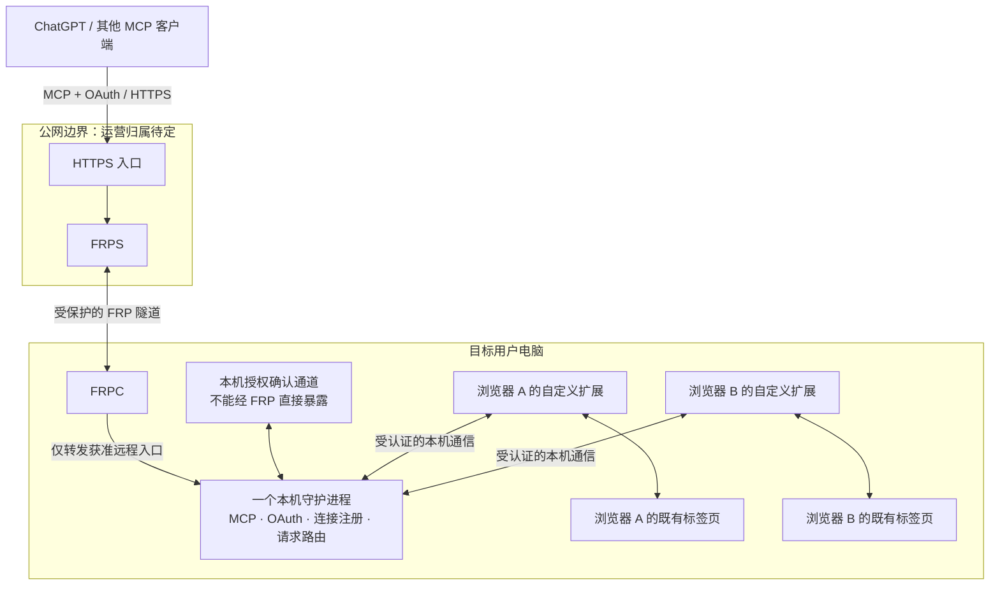

# Avru 技术设计

## 1. 设计状态与输入

本文将 [产品需求](requirements.md) 转为可继续细化的技术边界。多浏览器连接、MCP OAuth、FRP、同机确认及安装方向已有用户依据；接口命名、具体通信协议、加密实现、部署方式和凭据生命周期尚未冻结。

下文使用三种表述：

- **已确认约束**：来自产品需求，不在实现时随意改变。
- **设计建议**：为满足约束提出的可评审方案，不冒充已确认决定或已实现能力。
- **待决定事项**：会影响后续实现，统一在 [开放问题](decisions.md#2-开放问题) 记录。

这是逻辑设计，不包含实现或验证回执。文中的数据字段和工具名称是接口草案，不是可调用 API。协议版本和第三方兼容性需在实现前核实。

## 2. 系统上下文与逻辑架构

图中的两个浏览器仅表示多对一关系，不预先确定支持 Chrome、Edge、Firefox 或 Safari 的具体集合。一个浏览器的多个配置也需要可区分身份，但配置支持范围仍待决定。

### 2.1 组件责任

| 组件 | 负责 | 不负责 |
| --- | --- | --- |
| MCP 客户端 / AI | 发现可用目标、理解任务、选择明确的浏览器和标签页、请求操作与核对结果 | 不持有扩展内部凭据，不凭页面内容提升权限 |
| 公网 HTTPS 入口 / FRPS | TLS 接入与设备入口路由、隧道承载 | 不能仅靠路由结果授予浏览器控制权 |
| FRPC | 建立目标电脑到公网服务的隧道，报告连接状态 | 不作为同机确认的身份依据 |
| 守护进程 | MCP 服务、授权状态、浏览器连接注册、目标校验、操作调度与结果关联 | 不把一个浏览器的连接与标签标识套到另一个浏览器 |
| 自定义扩展 | 连接守护进程、报告自身能力与标签页、执行受支持的浏览器动作、反馈页面状态 | 不绕过浏览器权限、系统页面限制或用户停止操作 |
| 本机确认入口 | 显示本次授权的目标电脑、客户端和控制范围，收集确认，经可信本机路径提交结果 | 不因公网网页访问到 loopback 或处于同一 NAT 就自动批准 |
| 安装入口 | 安装持久运行组件、配置自启动、引导扩展安装、检查连接状态 | 不把退出 npx 终端等同于停止已安装服务，也不承诺扩展静默安装 |

公网入口、OAuth 授权服务及证书的最终运营位置仍须确定。图按前述讨论把 MCP 与授权管理放在守护进程；是否引入独立云端授权组件属于重大变更，不能在实现中悄悄替换。

### 2.2 信任边界

1. AI/MCP 客户端与公网入口之间：OAuth 身份、授权范围、TLS 与请求有效性。
2. 公网/FRP 与目标电脑之间：隧道认证与设备路由；远程可调用接口和本机确认接口必须隔离。
3. 守护进程与扩展之间：连接来源认证、协议版本和目标身份绑定。
4. 扩展与网站页面之间：网页数据不可信；页面脚本或文字不能发起管理级命令或修改授权。
5. 不同电脑、操作系统账号、浏览器配置之间：身份与授权不能因名称相同而合并。跨 OS 账号策略是 Q-02 的阻塞项。

如果公网代理终止 TLS，它可能接触页面文本、截图和操作数据，不能声称“云端看不到”。TLS 终止位置、隧道保护以及运营者可见性必须在部署设计中明确。

## 3. 多浏览器发现与目标路由

### 3.1 已确认的使用体验

连接完成后，AI 一次发现所有已连接浏览器及其标签页，自行判断任务需要操作哪一个。用户不需要先在扩展里选一个标签页才能让 AI 看到它，也不需要逐个浏览器授权后再切换。

“全部可见”指可发现目标集合，不要求在连接时把所有标签页的全文和截图一次发送给 AI。建议先返回目标元数据，再按任务读取页面内容，降低无关数据暴露和结果体积。

### 3.2 建议的身份模型

| 对象 | 草案身份与状态 | 作用 |
| --- | --- | --- |
| Device | deviceId、安装身份、当前运行实例 | 区分物理目标安装，不能仅用设备名称或 IP |
| BrowserConnection | connectionId、浏览器/配置显示名、连接代次、能力、在线状态 | 区分同浏览器多个连接，代次防止重连后旧引用误用 |
| Tab | connectionId + tabId + 连接代次，页面版本 | 浏览器 tabId 只在其自身上下文内解释 |
| AuthorizationGrant | 客户端、目标设备、允许范围、状态 | 将 OAuth 授权绑定到正确设备，具体期限/刷新机制待定 |
| Operation | requestId、授权身份、目标引用、动作、状态 | 把执行结果关联回原请求，不以“已转发”冒充成功 |

这些是逻辑字段，不确定数据库、序列化格式或最终公开命名。标签页关闭、浏览器重连、配置切换和页面导航后，要重新判断目标引用是否仍有效。

### 3.3 发现结果与执行语义建议

- 发现结果包含浏览器连接、标签页标识、可用标题/URL、活动状态、可执行能力和受限原因。标题与 URL 也可能敏感，只发给已授权客户端。
- 跨浏览器的相同 tabId 不得相互替代。目标失效时返回明确错误，不自动切换到相似标题的页面。
- 读取后的页面引用应绑定页面版本或导航代次。页面已变化时重新观察，避免按过期定位点击。
- 多客户端或多任务同时操作同一标签页时，建议串行处理写操作或返回冲突；不能交错输入导致无法归因的结果。是否支持多客户端并发见 Q-09。
- 用户主动操作、导航和关闭页面都应触发状态更新。不能把上一次截图当成当前页面事实。
- 新连接是否继承既有 grant 由 Q-04 决定；无论采用何种生命周期，都保持 AI 不必人工逐页选目标的已确认体验。

## 4. MCP 能力与接口草案

MCP 是正式对外接口，OAuth 是正式远程授权方式。传输版本、客户端注册方式、服务发现与兼容范围仍需按选定 MCP 规范核对，不能仅凭服务返回 JSON 就宣称兼容 ChatGPT。

建议按“发现 → 观察 → 操作 → 验证”组织工具：

| 能力组 | 草案输入 | 草案输出 | 当前状态 |
| --- | --- | --- | --- |
| 发现浏览器与标签页 | 分页/过滤条件（如最终需要） | 完整可分页目标集合、能力、在线/受限状态 | R-03、R-04 所需；具体 schema 待定 |
| 观察页面 | 明确目标引用、读取方式 | 文本/结构/截图、页面版本、受限或截断说明 | 先前建议，具体范围待确认 |
| 执行浏览器动作 | 目标引用、动作、参数、前置页面状态 | 执行状态、后置状态或结果引用 | 点击、输入等候选，完整动作集待确认 |
| 连接与控制状态 | 当前连接或操作引用 | 在线状态、当前操作、失败原因 | 建议 |
| 停止控制 / 撤销授权 | 具体授权或操作对象 | 撤销/停止结果及未能撤回的已执行动作 | 安全设计建议，语义待确认 |

公开接口应区分协议错误、授权失败、目标离线、标签页不存在、页面已变化、页面不可访问、动作不支持、排队冲突、超时与结果未知。错误不能一律包装为成功文本。

对可能产生副作用的动作，建议输出“未执行”“已执行且已核对”“可能执行但结果未知”等状态。不能在超时后自动重放点击、提交表单或输入操作。只读操作的重试也需重核目标与授权。

本版不提供任意 shell、读写本地文件或不受限制的 JavaScript 执行能力。它们不是 MCP 的默认能力，也不因浏览器扩展已连接而成立。

## 5. 同机 OAuth 授权设计

### 5.1 安全目标与明确允许的情况

- 只有经目标电脑上可信本机组件的用户确认，才能建立控制该电脑的 grant。
- 用户无需记、复制、输入 token，必要凭据由软件内部产生、保存和使用。
- 允许远程桌面操作目标电脑。目标是确认路径经过这台电脑，不是证明人坐在现场。
- 仅在其他电脑打开公网授权链接不能完成目标电脑授权；其他电脑安装了 Avru 也不能替代目标身份。
- 仅持有目标电脑名称、IP、公开链接或 FRP 通道不足以授权。

同机确认不能抵御已经控制目标操作系统账号或受信本机组件的攻击者。安装身份的复制、备份恢复及虚拟机克隆也需要在具体方案中处理，不能把一个可复制标识直接宣称为硬件级同机证明。这是本设计的能力边界，不应描述成强人身认证或硬件级可信证明。

### 5.2 建议流程，尚未冻结

1. MCP 客户端通过选定的标准 OAuth 流程发起授权。建议采用授权码及 PKCE，并按所选 MCP 规范验证客户端、redirect URI、state、资源标识等。
2. 系统建立一次待确认请求，绑定目标安装身份、客户端、授权范围、随机挑战、有效期及回调约束。
3. 公网页面显示在目标电脑完成确认的提示。打开这个页面本身不产生授权。
4. 目标电脑的受信扩展页面或本地 UI 经已认证的本机通道取得该请求，显示目标、客户端及范围，等待用户明确允许或拒绝。
5. 本机组件将确认与这次挑战、目标设备和授权请求绑定；服务端验证后原子消费挑战，拒绝过期、重放、跨设备替换与范围篡改。
6. 标准 OAuth 回调和凭据签发完成。只有符合对应 grant 的请求能到达浏览器操作层。
7. 用户可查看、停止或撤销授权；刷新、有效期和撤销生效方式仍需 Q-07 定案。

本流程是安全设计候选，不是已证明安全的协议。需要对具体客户端与浏览器实现验证。不能用“请求看起来来自 localhost”替代第 4–5 步。

### 5.3 本机通道候选与选择条件

**候选 A：浏览器 Native Messaging + 每次安装的本机身份。**

- 扩展通过浏览器允许的原生消息通道到达本机桥接程序，再连接唯一守护进程。
- 需处理允许扩展 ID、不同浏览器注册方式、安装位置和消息格式；桥接程序不是第二套独立控制守护进程。
- 优点是页面不能直接冒充扩展发起原生消息。仍需防止本地恶意进程、扩展身份混用和错误设备绑定。
- 不同浏览器支持程度和安装体验要实测。

**候选 B：受认证的 loopback 通道。**

- 需限定监听地址，并校验 Host/Origin、连接身份、挑战与 CSRF；拒绝 DNS rebinding、跨站请求和未经授权的 WebSocket。
- loopback 不是身份认证；同机其他进程和恶意网页可能尝试访问。
- 浏览器对公网页面访问本地服务的限制、混合内容和本地网络访问策略可能影响实现，不能预先保证无提示可用。

两者都不能让用户手抄 token。最终选择取决于目标浏览器矩阵、安装约束和安全验证，属于 Q-03。

### 5.4 远程与本机入口隔离

建议让远程 MCP/OAuth 协议入口与本机批准入口分离监听或具有不可混用的路由与身份要求：

- FRPC 只映射获准远程接口，不暴露扩展管理、原生消息桥、调试端口或本机批准端点。
- 从 FRP 进入的请求即使在本地转发为 loopback，也继续被视为远程请求。
- 公网路由不能通过参数、反向代理路径或内部转发触达本机批准动作。
- HTTP Host/Origin 检查是额外防线，不单独承担同机证明。
- OAuth 凭据不透传到网站，不与 FRP 凭据或本机组件身份混用。

## 6. 安装、启动与生命周期

### 6.1 安装闭环建议

1. 用户执行将来正式发布的 npx 安装入口。
2. 检查平台、架构、运行环境、已有安装和冲突；明确任何需要的系统权限，不默认提权。
3. 将常驻运行所需文件安装到稳定位置，而非依赖 npx 临时缓存。
4. 建立安装身份及必要配置，注册用户登录后的启动项。
5. 启动守护进程和所需 FRPC 组件，检测本机服务、隧道及公开入口状态。
6. 引导打开受支持浏览器的官方扩展安装页，由用户完成浏览器要求的确认。
7. 扩展接入，显示全部已连接浏览器；分别报告安装完成、扩展已连接、公网链路可用和 OAuth 已授权。

这些状态必须分开。已安装不等于扩展已安装，隧道在线也不等于客户端已获授权。

### 6.2 平台适配建议

- macOS：优先评估用户级 LaunchAgent；准确路径、签名、公证、支持架构及权限待定。
- Windows：评估用户登录触发的计划任务或合适的用户级启动方案；不预先承诺需要管理员权限的系统服务。
- “一个守护进程”在多 OS 账号场景的语义未定，先解决 Q-02，再选择安装与互斥机制。
- FRPC 是由守护进程管理的子进程还是独立托管组件、版本与更新方式，待 Q-01/Q-06 决定。
- npm 包名与发行主体尚未核实；不能把示例 npx 命令写成已经可用的产品命令。

### 6.3 故障、恢复和退出建议

| 情况 | 建议行为 |
| --- | --- |
| 扩展未安装或浏览器未启动 | 显示未连接；不反复启动或控制别的浏览器 |
| 扩展/浏览器重连 | 重新注册连接代次、刷新标签页；旧目标引用需重新解析 |
| 守护进程崩溃或电脑重新登录 | 由受控自启动机制恢复；重新核对配置、授权与连接，不重放未知副作用 |
| 电脑休眠、用户退出、网络中断 | 明确离线；恢复后重新握手，不承诺后台继续操作 |
| FRP 隧道断开 | 远程能力不可用；本机状态可保留，是否有离线控制入口未定 |
| 用户拒绝/取消/超时授权 | 不签发有效 grant；清理待确认状态 |
| 撤销授权与请求同时发生 | 执行前再次核对；未执行请求拒绝，已经发生的网页副作用不能保证撤销 |
| 用户停止控制 | 停止新的操作并尽力取消未开始请求；报告已执行部分，不谎称业务回滚 |
| 安装或升级部分失败 | 显示实际完成步骤与剩余状态；恢复或回滚机制需在发行设计时确定 |
| 卸载 | 需要清晰处理启动项、守护进程、FRPC、授权及本机数据；具体数据保留选择未定 |

升级、回滚、卸载与凭据迁移属于必要的后续运行设计，但本次不执行任何安装或系统设置变更。

## 7. 数据与隐私设计建议

- 本机持久数据候选：安装身份、配置、有效授权记录及最小运行元数据。具体存储方式与跨版本迁移未定。
- 扩展连接、标签页清单、页面定位引用和操作排队状态宜按会话管理；恢复后重新观察，不把过期数据当作现场。
- 凭据应使用操作系统支持的安全保存方式或有明确保护的替代方案；不得进入源码、日志、MCP 输出或网页 DOM。具体密钥模型待定。
- 页面全文与截图默认按请求临时处理，避免为了“看到所有标签”而无差别采集所有内容。保留时长、审计开关和云端日志策略必须明确后再实现。
- 日志建议记录请求 ID、目标引用、动作类别、授权判定和结果状态；不默认记录表单输入、完整 URL 查询参数、截图或 token。
- 诊断信息应能关联故障，但不能把未经用户允许的数据发送到第三方分析服务。
- 私密模式、浏览器系统页面、文件 URL、密码字段、下载与上传需要独立权限决定，见 Q-05/Q-08。

## 8. 威胁与验证重点

以下是设计评审与未来测试关注点，均未执行：

| 风险 | 建议防线 | 应验证的反例 |
| --- | --- | --- |
| 授权链接转到其他电脑 | 目标安装身份 + 受信本机确认 + 单次挑战 | B 电脑打开 A 的链接不能批准 A；B 的本地 Avru 也不能批准 A |
| FRP 将远程请求伪装为本机请求 | 入口隔离、远程属性保留、独立本机身份 | 通过公网请求批准接口、代理路径或端口均失败 |
| 挑战/授权码重放或篡改 | 绑定客户端、目标、范围、时效及原子消费 | 重用、改目标、改范围、过期、并发重复批准不产生额外授权 |
| 恶意网页攻击本机服务 | 通道认证、Origin/Host、CSRF、防 rebinding | 非扩展页面不能获得本机确认权限 |
| 多浏览器标识碰撞 | 复合目标身份、连接代次、执行前核对 | 两浏览器同 tabId 不串线，旧连接引用不落到新标签 |
| 页面内容诱导越权 | 页面数据与控制指令隔离，权限由客户端与服务端检查 | 页面提示不能授予新权限或读取凭据 |
| 超时引发重复副作用 | 请求状态与未知结果处理，禁止盲重放 | 已提交但回执丢失时不自动再提交 |
| 授权撤销与并发操作竞争 | 执行前校验和一致的撤销状态 | 撤销后新请求拒绝；已发生动作准确披露 |
| 浏览器权限差异 | 能力协商与明确不支持结果 | 受限页面或缺权限不伪装成功 |
| 凭据与浏览数据泄漏 | 最小输出、日志脱敏、传输与存储保护 | 日志、错误、MCP 响应和网页 DOM 无内部凭据 |

公网上线前必须确定入口运营者、TLS/隧道保护、授权端点与本机确认的真实边界，并完成对应反例测试。文档中画出隔离边界并不证明实现隔离成立。

## 9. 需求到设计的追踪

| 需求 | 本文响应 | 仍依赖的决定 |
| --- | --- | --- |
| R-01 | §1、§2 的独立系统范围 | 无新增产品归属决定 |
| R-02 | §2 组件、§3 路由 | Q-03、Q-08 |
| R-03 | §2 多对一、§3 身份 | Q-02、Q-10 |
| R-04 | §3 全量发现与 AI 选择 | Q-04、Q-05 |
| R-05 | §4 MCP 接口 | Q-07、Q-08 |
| R-06 | §5 OAuth | Q-03、Q-07 |
| R-07 | §2 公网链路、§5.4 隔离 | Q-01、Q-06 |
| R-08、R-09、R-10 | §5 同机确认及内部凭据 | Q-03、Q-07 |
| R-11 | §6.1 安装闭环 | Q-06、Q-10 |
| R-12 | §6.2 平台、§6.3 恢复 | Q-02、Q-06、Q-10 |

本文覆盖确认方向及其实现所需的边界，保留显式缺口。没有声称已完成架构安全证明、客户端兼容测试或产品验收。
