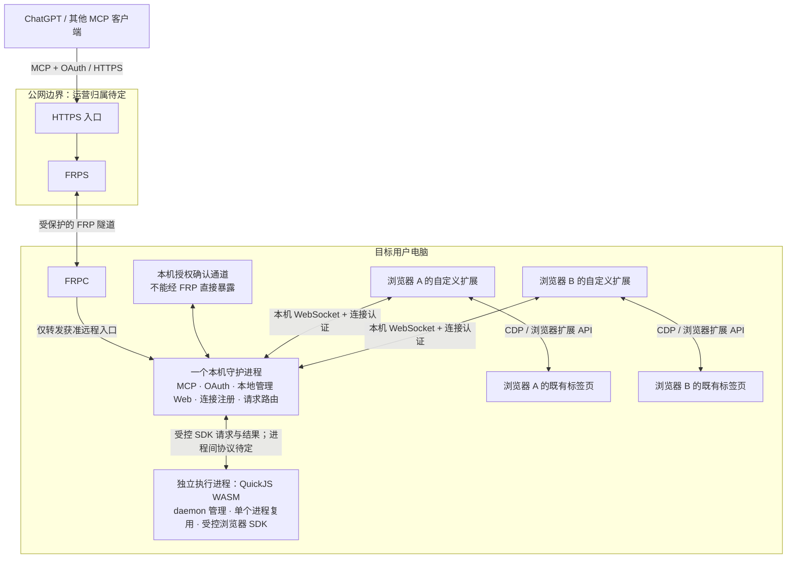

# 架构与工程边界

目标架构不等于完整实现。需求见[产品需求](../requirements.md)，选型编号见[决定](decisions.md)，实施状态见[开发计划](../development/README.md)。

## 系统上下文与逻辑架构

图中的两个浏览器仅表示多对一关系，不预先确定支持 Chrome、Edge、Firefox 或 Safari 的具体集合。一个浏览器的多个配置也需要可区分身份，但配置支持范围仍待决定。

### 组件责任

| 组件                   | 负责                                                                                                                 | 不负责                                                                                                |
| ---------------------- | -------------------------------------------------------------------------------------------------------------------- | ----------------------------------------------------------------------------------------------------- |
| MCP 客户端 / AI        | 发现可用目标、理解任务、选择明确的浏览器和标签页、请求操作与核对结果                                                 | 不持有扩展内部凭据，不凭页面内容提升权限                                                              |
| 公网 HTTPS 入口 / FRPS | TLS 接入与设备入口路由、隧道承载                                                                                     | 不能仅靠路由结果授予浏览器控制权                                                                      |
| FRPC                   | 建立目标电脑到公网服务的隧道，报告连接状态                                                                           | 不作为同机确认的身份依据                                                                              |
| 守护进程               | MCP 服务、授权状态、浏览器连接注册、目标校验、操作调度与结果关联；提供本地管理 Web                                   | 不把一个浏览器的连接与标签标识套到另一个浏览器                                                        |
| 本地管理 Web           | 浏览器选择、扩展安装引导、连接方式配置、运行状态展示                                                                 | 不静默安装扩展，不要求用户在 AI 每次操作前手动选择目标，不因打开页面自动授予 OAuth 权限               |
| 自定义扩展             | 经本机 WebSocket 连接守护进程，报告能力与标签页；使用 CDP / 扩展 API 执行动作并反馈页面状态                          | 不绕过浏览器权限、系统页面限制或用户停止操作                                                          |
| QuickJS WASM 执行进程  | 由 daemon 管理生命周期，加载 WASM 引擎执行 AI 脚本，通过受控浏览器 SDK 请求守护进程操作；单个独立进程复用            | 不直接连接扩展，不持有 OAuth/配对密钥，不获得通用 shell、文件或网络访问；进程复用不等于跨任务共享状态 |
| 本机确认入口           | 显示本次授权的目标电脑、客户端和控制范围，收集确认，经可信本机路径提交结果                                           | 不因公网网页访问到 loopback 或处于同一 NAT 就自动批准                                                 |
| CLI / npx 入口         | 首次安装与自启动配置；重跑检查更新并保留设置；确保守护进程启动、打开本地管理 Web；通过独立卸载命令停止服务并清理安装 | 不代装用户的 Node.js/npm，不承担 Web 的浏览器/连接配置交互，不把退出 npx 终端等同于停止已安装服务     |

公网入口、OAuth 授权服务及证书的最终运营位置仍须确定。图按前述讨论把 MCP 与授权管理放在守护进程；是否引入独立云端授权组件属于重大变更，不能在实现中悄悄替换。

### 信任边界

1. AI/MCP 客户端与公网入口之间：OAuth 身份、授权范围、TLS 与请求有效性。
2. 公网/FRP 与目标电脑之间：隧道认证与设备路由；远程可调用接口和本机确认接口必须隔离。
3. 守护进程与扩展之间：连接来源认证、协议版本和目标身份绑定。
4. 扩展与网站页面之间：网页数据不可信；页面脚本或文字不能发起管理级命令或修改授权。
5. QuickJS 与守护进程之间：脚本请求不可信，守护进程在每次实际 SDK 操作前检查授权、目标与动作范围；执行引擎本身不是权限判定者。
6. 不同电脑、操作系统账号、浏览器配置之间：身份与授权不能因名称相同而合并。跨 OS 账号策略是 Q-02 的阻塞项。

如果公网代理终止 TLS，它可能接触页面文本、截图和操作数据，不能声称“云端看不到”。TLS 终止位置、隧道保护以及运营者可见性必须在部署设计中明确。

### 服务端、管理 Web、存储与测试选型

D-14 确认以下工程选型。此处记录组件的目标责任边界，不表示完整功能已实现；初始依赖与开发入口的验证范围见本文件“工程边界”。

| 领域               | 已选技术                | 责任与边界                                                                                                                                                                             |
| ------------------ | ----------------------- | -------------------------------------------------------------------------------------------------------------------------------------------------------------------------------------- |
| 守护进程 HTTP 服务 | Fastify                 | 承载 HTTP 路由及本地管理 Web/API；远程 MCP/OAuth 与本机配对/确认入口按 [MCP 授权](mcp.md)分隔。框架本身不提供已验证的同机授权方案。                                                    |
| 本机 WebSocket     | ws                      | 在 daemon 侧实现扩展连接及协议处理；扩展侧使用浏览器 WebSocket API。沿用 D-11 的认证、身份、重连和消息限额要求，不以选库替代协议合同。                                                 |
| MCP 协议           | 官方 MCP TypeScript SDK | 实现对外 MCP 协议接入；具体 SDK/协议版本、HTTP 传输接线、OAuth 合同及目标 ChatGPT 兼容测试待定，不能把 SDK 接入等同于授权已实现。                                                      |
| 本地管理 Web       | React + Vite            | React 组织管理交互，Vite 负责开发与构建；目标是由 daemon 提供构建后的管理页面，不要求终端用户另开开发服务器。不得据此扩大 Web 的授权范围。                                             |
| 本机持久化         | SQLite，暂不引入 ORM    | 保存经确认需要持久化的数据；本机配对表与访问层已有连接合同，未来迁移仍需设计，不承诺自动跨数据库适配。敏感凭据保护仍遵循 [数据与安全](security.md)，不因选择 SQLite 就默认以明文入库。 |
| 测试               | Vitest + Playwright     | Vitest 用于单元/集成测试，Playwright 用于适用的浏览器/Web 端到端验证；Playwright 是测试工具，不替换产品运行时的扩展 + WS + CDP 路线。                                                  |

该组合将服务路由、连接、协议、管理界面、存储和验证工具分工明确；采用现成框架仍需维护依赖兼容、适配层与安全合同。SQLite 对应本机数据需求，本轮没有批准云端 PostgreSQL、多租户存储或 ORM 引入。测试框架选择不构成浏览器真实连接、跨平台安装或安全验收通过的证据。

已安装依赖的开发版本由 package.json / pnpm-lock.yaml 固定，工程基线见本文件“工程边界”；完整产品支持范围、未来数据库迁移与 MCP 接线仍待确定；本机配对存储和 WS 接线见 [本机连接](browser-connection.md)。QuickJS 的具体 WASM 包/版本、runner IPC 和任务调度仍见 Q-14；远程同机授权和 OAuth 生命周期仍见 Q-03/Q-07；首次配对本机子集已有实现合同。

### 工程边界

采用 pnpm workspace 单仓库，Node.js 24.22.1、pnpm 11.25.0 为当前开发基线；依赖精确版本由 package.json 与 pnpm-lock.yaml 拥有。支持范围不能从开发版本推定。

| 目录              | 唯一责任                                                 |
| ----------------- | -------------------------------------------------------- |
| apps/cli          | 安装、更新、修复、启动、卸载与打开 Web                   |
| apps/daemon       | 本机可信连接、鉴权、目标路由与页面托管；未来承载远程 MCP |
| apps/web          | 管理交互，不自行作出授权决定                             |
| apps/extension    | WXT 扩展，WS 接入与浏览器允许的操作                      |
| packages/protocol | 跨组件协议边界；现有连接合同见 browser-connection.md     |
| packages/runner   | 独立 QuickJS WASM 执行器边界，尚未实现                   |
| tests/e2e         | 真实跨组件验收，不替代用户机器和发行验收                 |

应用不得互相导入；共享协议不得导入应用/runner；runner 不导入应用，UI 不导入 runner。具体检查配置与例外见[质量指南](../guide/quality.md)。安装、自启动和 WS 现有实现不再使用初始骨架的“只有 help/health”描述；当前进度统一见[开发计划](../development/README.md)。
